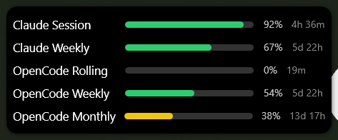
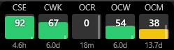
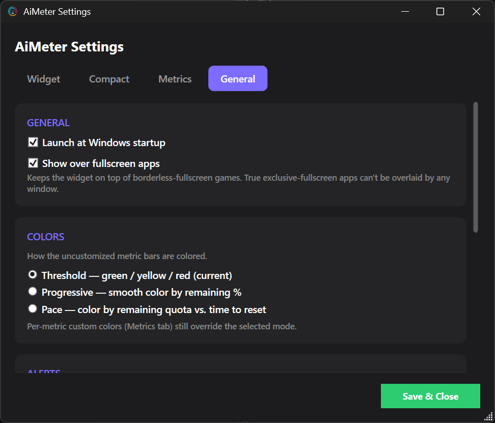

# AiMeter

A lightweight Windows desktop app that keeps your AI service usage limits visible at a
glance. AiMeter lives in the system tray and shows a small always-on-top widget that
tracks remaining quota and reset timers across AI providers.

It currently tracks **Claude** (claude.ai session/weekly limits and Extra Usage) and
**OpenCode** (opencode.ai Go rolling/weekly/monthly usage, read from the OpenCode Console), side by side, on an extensible provider
architecture designed for OpenAI, Gemini, Grok, OpenRouter, DeepSeek, and others.

| Compact | Taskbar |
|---------|---------|
|  |  |

**Deskband** — the bars embedded inside the Windows 11 taskbar:


**Settings** — tabs for Widget, Compact, Metrics and General (colors, alerts, accounts):



## Download

**Latest release: v2.0.1** —
[AiMeter.exe](https://github.com/LanternOfDarkness/AiMeter/releases/download/v2.0.1/AiMeter.exe)
(30.0 MiB)

```
SHA-256: 705E5A61E7C58F13B33AD869271AFE3E31F94D661868AB8F083C59545EE84F4A
```

A single framework-dependent `AiMeter.exe` for **win-x64** — no zip, no loose files. It needs
the .NET 10 Desktop Runtime and the WebView2 Runtime (see [Requirements](#requirements)); just
download it and run. Verify the download with
`Get-FileHash AiMeter.exe -Algorithm SHA256`.

An Inno Setup installer (`installer/aimeter.iss`) is also available in this repo — see
[Installation](#installation) to build and run it locally. It isn't code-signed, so Windows
SmartScreen will warn on first run; a signed, hosted installer release is tracked as a
follow-up (see [docs/design.md](docs/design.md)).

See [CHANGELOG.md](CHANGELOG.md) for release notes.

## What's new in v2.0.1

- **OpenCode works again** after opencode.ai's console redesign — Go usage is now read from
  your workspace's *Activity ▸ My usage* page. Rolling, Weekly and Monthly meters and their
  reset times are back, and a slow-loading page no longer shows up as "No active Go
  subscription".
- **Deskband no longer clips** — the in-taskbar band sizes itself to its content, so long
  labels and reset times (`13d 17h`) aren't cut off at the right edge.

v2.0.0 added the **Deskband** layout, **Progressive & Pace** bar coloring, the single-exe
release and the move to .NET 10 — see [CHANGELOG.md](CHANGELOG.md).

## Features

- **Multiple providers** — track Claude and OpenCode together; log into each under
  Settings → General → Accounts. Deselect any metric you don't want on the widget.
- **Claude Extra Usage** — tracks Claude's pay-as-you-go spend limit as a dollar figure
  (`$used / $limit`) with a proportional bar. On an "Unlimited" Extra Usage plan (no monthly
  cap), it shows the prepaid balance left instead, with no bar.
- **Floating widget** — always-on-top, draggable, remembers its position (and can sit over
  the taskbar).
  - **Compact** layout: a slim strip of thin bars with % and a short reset label (`5h`, `2d 3h`).
    Customizable from Settings → Compact (bars-per-column, which wraps into extra columns; bar
    width; cell/column gaps), Settings → Widget (font size, and a toggle to hide the
    always-visible numbers — they stay one hover away) and Settings → Metrics (per-metric
    custom label and bar color).
  - **Taskbar** layout: docks flush against the bottom of the screen, overlapping the
    taskbar — one thin vertical-fill column per metric showing a 3-letter code, the quota
    fill, the remaining % and a compact reset countdown (`3.3h`, `5.2d`) all at rest; hover a
    column for the full name and verbose reset time.
  - **Deskband** layout (Windows 11 24H2+): embeds the same Compact bars *inside* the taskbar —
    two rows per column, wrapping into extra columns to the right, and sized to fit its
    content — kept clear of the Start button, app buttons and the notification area. Explorer restarts, DPI changes and monitor
    disconnects are recovered automatically.
- **Bar coloring modes** (Settings → General → Colors) — color uncustomized bars by the fixed
  green/yellow/red **Thresholds** (default), a smooth **Progressive** remaining-% gradient, or
  **Pace** (remaining quota versus time to reset). Per-metric custom colors still win.
- **Log in required** — once the first poll completes, if no provider is logged in at all the
  widget shows a single "Log in required" call-to-action (instead of per-provider error
  tiles); click it to jump straight to Settings.
- **Widget controls** — hover the widget for Refresh / Settings / Switch Layout / Hide (they
  fade in at the top-right), or right-click anywhere on it for the same menu.
- **Reset countdowns** that stay live and format long windows as days + hours.
- **System tray** app: show/hide widget, open settings, refresh, exit.
- **Launch at startup** — optionally start AiMeter when you sign into Windows.
- **Stay over fullscreen** — keeps the widget above borderless-fullscreen games (toggle in
  Settings → General). True exclusive-fullscreen apps can't be overlaid by any window.
- **Game mode** — while a borderless-fullscreen game has focus on the widget's own monitor,
  the widget automatically becomes click-through: still visible and on top, but clicks pass
  straight through to the game. Reverts instantly when a normal window regains focus.
- **Adjustable opacity** with an on-hover dim, or turn opacity off entirely.
- **Configurable notifications** for low, exhausted, and reset quotas.
- **Pick which metrics are shown** (Settings → Metrics) — deselected metrics stay listed so
  you can re-enable them.

## Quota color states

With the default **Threshold** coloring mode:

| Remaining | Color |
|-----------|-------|
| 75–100%   | Green |
| 50–75%    | Blue |
| 25–50%    | Orange |
| 10–25%    | Red |
| 0–10%     | Dark red |
| Unknown   | Gray |

Switch to **Progressive** for a smooth gradient by remaining %, or **Pace** to color by
remaining quota versus time-to-reset (Settings → General → Colors). Per-metric custom colors
override all modes.

**Time bar** (Taskbar mode only): a thin sliver alongside each column's quota fill that fills
as the reset approaches — empty right after a reset, full just before the next one.

## Getting started

### Requirements
- Windows 11 24H2 (build 26100) or later
- [.NET 10 SDK](https://dotnet.microsoft.com/download)
- [WebView2 Runtime](https://developer.microsoft.com/microsoft-edge/webview2/) — preinstalled
  on Windows 11; both providers log in and fetch through it.

### Build & run
```powershell
dotnet build src/AiMeter/AiMeter.csproj
dotnet run --project src/AiMeter/AiMeter.csproj
```

### Installation

To build the installer instead of running from source, publish a framework-dependent
build and compile it with [Inno Setup 6](https://jrsoftware.org/isinfo.php):
```powershell
dotnet publish src/AiMeter/AiMeter.csproj -c Release -r win-x64 --self-contained false -o publish/win-x64
iscc installer/aimeter.iss
```
This produces `installer/Output/AiMeter-setup-x64.exe`. Running it installs AiMeter to
`%LocalAppData%\Programs\AiMeter` — per-user, no admin/UAC prompt — with optional "Launch at
Windows startup" and desktop-shortcut checkboxes (both checked by default), and it checks
for and silently installs the .NET 10 Desktop Runtime and WebView2 Runtime prerequisites if
they're missing. Uninstalling removes the app but leaves `%AppData%\AiMeter` (your settings
and logs) untouched by default; you're asked once whether to remove those too.

### Single-file build

```powershell
# Framework-dependent single exe (needs .NET 10 Desktop Runtime; default)
dotnet publish src/AiMeter/AiMeter.csproj -c Release -r win-x64 --self-contained false `
  -p:PublishSingleFile=true -o publish/win-x64

# Self-contained single exe (~65 MB; no .NET prerequisite; still needs WebView2 Runtime)
dotnet publish src/AiMeter/AiMeter.csproj -c Release -r win-x64 --self-contained true `
  -p:PublishSingleFile=true -o publish/win-x64-full
```

The release ships as a single `AiMeter.exe` (see [Download](#download));
`installer/aimeter-full.iss` builds the self-contained variant.

On first run, open **Settings → General → Accounts** and log into Claude.ai and/or opencode.ai to
fetch your usage limits — each provider has its own login row. Authentication runs in an
embedded browser; only a lightweight "logged in" marker is stored locally (the real session
lives in the WebView2 profile). Log into just the providers you use.

## Configuration

Settings are stored as JSON at:
```
%AppData%\AiMeter\settings.json
```
This includes widget opacity, layout mode (Compact / Taskbar / Deskband), bar coloring mode,
saved position, selected metrics, polling interval, and notification preferences. The embedded
browser session lives alongside it in `%AppData%\AiMeter\WebView2`.

Diagnostic logs are written daily to `%AppData%\AiMeter\logs\aimeter-{yyyy-MM-dd}.log` and
capture provider fetch failures, session expiry, and settings load/save errors — useful when
metrics stop updating with no visible explanation.

## Architecture

- **.NET 10 · WPF · MVVM** with `CommunityToolkit.Mvvm` and `Microsoft.Extensions.Hosting` DI.
- `IProvider` implementations fetch usage; `ProviderManager` polls, caches last-good data,
  filters by selection, and raises quota alerts.
- The widget and settings share a single live `AppConfig` singleton, persisted by
  `SettingsManager`.

See [docs/design.md](docs/design.md) for the full design document.

## License

See repository for license details.
