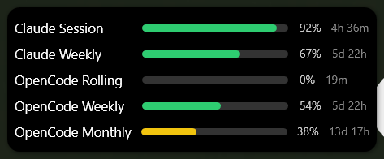

# AiMeter

A small Windows tray app that keeps your AI usage limits in view. An always-on-top widget
shows how much quota you have left and when it resets, for **Claude** (session, weekly and
Extra Usage limits) and **OpenCode** (Go rolling, weekly and monthly usage).

**Website:** [lanternofdarkness.github.io/AiMeter](https://lanternofdarkness.github.io/AiMeter/)

| Compact | Taskbar |
|---------|---------|
|  |  |

**Deskband**: the bars embedded inside the Windows 11 taskbar.


## Download

**Latest release: v2.1.0**:
[AiMeter.exe](https://github.com/LanternOfDarkness/AiMeter/releases/download/v2.1.0/AiMeter.exe)
(30.1 MiB, win-x64)

```
SHA-256: 85A49FA865E751AD9D765A4625E72593CBA55365AB8797B954B2A53A4F605263
```

It's a single portable `AiMeter.exe`: no installer, no zip. Put it in any folder you can
write to (so it can update itself) and run it. To check the download:
`Get-FileHash AiMeter.exe -Algorithm SHA256`.

**"Windows protected your PC"**: the exe isn't code-signed yet, so SmartScreen may warn the
first time you run a new version. Click **More info → Run anyway**.

Release notes for every version are in [CHANGELOG.md](CHANGELOG.md).

### Requirements

- Windows 11 24H2 (build 26100) or later, x64
- [.NET 10 Desktop Runtime](https://dotnet.microsoft.com/download/dotnet/10.0); Windows offers
  to install it on first run if it's missing
- [WebView2 Runtime](https://developer.microsoft.com/microsoft-edge/webview2/), preinstalled on
  Windows 11

### First run

Open **Settings → General → Accounts** and log into Claude.ai and/or opencode.ai. Each
provider has its own login row, and you only need the ones you use. You sign in on the
provider's own page in an embedded browser. The session stays in that browser's profile on
your PC; AiMeter stores only a "logged in" marker.

## What's new in v2.1.0

- **Updates from the tray.** AiMeter checks GitHub for new releases and asks before
  downloading anything. The download is verified before it replaces the exe. See
  [Updates](#updates).
- **Last known values when offline.** If a provider can't be reached, the widget keeps the
  last bars, dimmed with an amber `⚠` and a tooltip showing their age.
- **OpenCode works again.** The OpenCode Console was redesigned; AiMeter now reads the
  console's own usage API instead of its pages.
- **Doesn't get stuck at startup.** If the embedded browser hangs while starting, AiMeter
  gives up after 30 s and tries again on the next refresh.
- **Aligned labels.** The widget uses a monospaced font, so labels line up in every layout.
- **Easier troubleshooting.** An *Open logs folder* button in Settings → General →
  Diagnostics, and every log line now shows the app version.

Full details: [CHANGELOG.md](CHANGELOG.md).

## Features

- **Claude and OpenCode together.** Track both side by side; deselect any metric you don't
  want on the widget (Settings → Metrics).
- **Claude Extra Usage** as a dollar figure (`$used / $limit`) with a bar. On an "Unlimited"
  plan it shows the prepaid balance left instead.
- **Three layouts.**
  - **Compact**: a slim, draggable strip of bars with % left and a short reset label (`5h`,
    `2d 3h`). Bars per column, bar width, gaps, font size, labels and colors are adjustable.
  - **Taskbar**: thin vertical columns docked over the taskbar, each with a short code, the
    fill, % left and a countdown (`3.3h`, `5.2d`). Hover a column for details.
  - **Deskband** (Windows 11 24H2+): the Compact bars inside the taskbar itself, kept clear of
    the Start button, app buttons and the notification area. It recovers from Explorer
    restarts, DPI changes and monitor changes.
- **Bar colors**: fixed **Thresholds** (default), a smooth **Progressive** gradient, or
  **Pace** (quota left versus time to reset). Per-metric custom colors override all modes.
- **Offline-safe**: last known values stay on screen, marked stale, and survive restarts.
- **Notifications** when a quota runs low, runs out or resets.
- **Game friendly**: stays above borderless-fullscreen games and becomes click-through while a
  game on the same monitor has focus. Exclusive-fullscreen apps can't be overlaid.
- **Widget controls**: hover for Refresh / Settings / Switch Layout / Hide, or right-click
  anywhere on the widget.
- **Tray app** with launch at sign-in, adjustable opacity and hover dimming.
- **Self-update** from GitHub Releases, only after you approve it.

### Quota colors (Thresholds mode)

| Remaining | Color |
|-----------|-------|
| 75–100%   | Green |
| 50–75%    | Blue |
| 25–50%    | Orange |
| 10–25%    | Red |
| 0–10%     | Dark red |
| Unknown   | Gray |

In Taskbar mode, a thin **time bar** beside each column fills as the reset approaches: empty
right after a reset, full just before the next one.

## Updates

- About 15 seconds after launch, and then at most once a day, AiMeter checks GitHub for a
  newer stable release. Turn this off in Settings → General → Updates.
- **Nothing is downloaded until you approve it.** A new version shows up as a tray item and a
  balloon; the update window downloads only after you press **Download & install**. To check
  by hand, use the tray menu's **Check for updates…** or Settings → General → Updates →
  **Check now**.
- **Later** hides the notification for 24 hours. **Skip this version** keeps that release off
  the tray until you check by hand.
- The download must match the release's SHA-256 **and** its embedded version before it
  replaces the running exe. The old file is kept as `AiMeter.exe.old` until the new one starts,
  and a failed replace rolls back.
- If a new version doesn't start: delete `AiMeter.exe` and rename `AiMeter.exe.old` back to
  `AiMeter.exe`.
- Builds that can't replace themselves (debug builds, or a folder you can't write to) link to
  the release page instead.

## Your data

AiMeter has no server and no telemetry. It connects only to claude.ai, opencode.ai and, for
update checks, GitHub. Everything it keeps is in `%AppData%\AiMeter`:

| File | Contents |
|------|----------|
| `settings.json` | Layout, colors, selected metrics, polling interval, notifications, position |
| `WebView2\` | The embedded browser profile that holds your provider sessions |
| `cache.json` | Last successful usage numbers and reset times (no credentials) |
| `update-state.json` | Update checks, skipped versions, notification times |
| `logs\aimeter-{yyyy-MM-dd}.log` | Daily diagnostic log |

Log lines start with the app version and source revision, for example
`2026-11-19 05:34:26 [v2.1.0+1de1699] [Warning] …`, so a pasted line identifies its build.
Open the folder from Settings → General → Diagnostics → **Open logs folder**.

See the [privacy policy](https://lanternofdarkness.github.io/AiMeter/privacy/).

## Building from source

Building needs the [.NET 10 SDK](https://dotnet.microsoft.com/download).

```powershell
dotnet build src/AiMeter/AiMeter.csproj
dotnet run --project src/AiMeter/AiMeter.csproj
dotnet test
```

Release build (the single `AiMeter.exe` that ships):

```powershell
dotnet publish src/AiMeter/AiMeter.csproj -c Release -r win-x64 --self-contained false `
  -p:PublishSingleFile=true -o publish/win-x64
```

Add `--self-contained true` for a ~65 MB exe that doesn't need the .NET runtime (WebView2 is
still required).

**Installer (optional, not published).** `installer/aimeter.iss` builds a per-user
[Inno Setup 6](https://jrsoftware.org/isinfo.php) installer from the publish output
(`iscc installer/aimeter.iss`; `aimeter-full.iss` for the self-contained variant). It installs
to `%LocalAppData%\Programs\AiMeter` without an admin prompt, can add a startup entry and a
desktop shortcut, and installs the .NET and WebView2 runtimes if they're missing. Uninstalling
keeps `%AppData%\AiMeter` unless you choose to remove it.

Publishing a release: [docs/releasing.md](docs/releasing.md).

## Architecture

- **.NET 10 · WPF · MVVM** with `CommunityToolkit.Mvvm` and `Microsoft.Extensions.Hosting`
  dependency injection.
- Each provider implements `IProvider`. `ProviderManager` polls them, caches the last good
  data, filters by your selection and raises quota alerts.
- Providers fetch through a hidden WebView2 that reuses your logged-in session.
- The widget and settings share one live `AppConfig`, saved by `SettingsManager`.

Full design notes: [docs/design.md](docs/design.md).

## License

[MIT](LICENSE) © 2026 VeLab. AiMeter is an independent project, not affiliated with or
endorsed by Anthropic or OpenCode.
