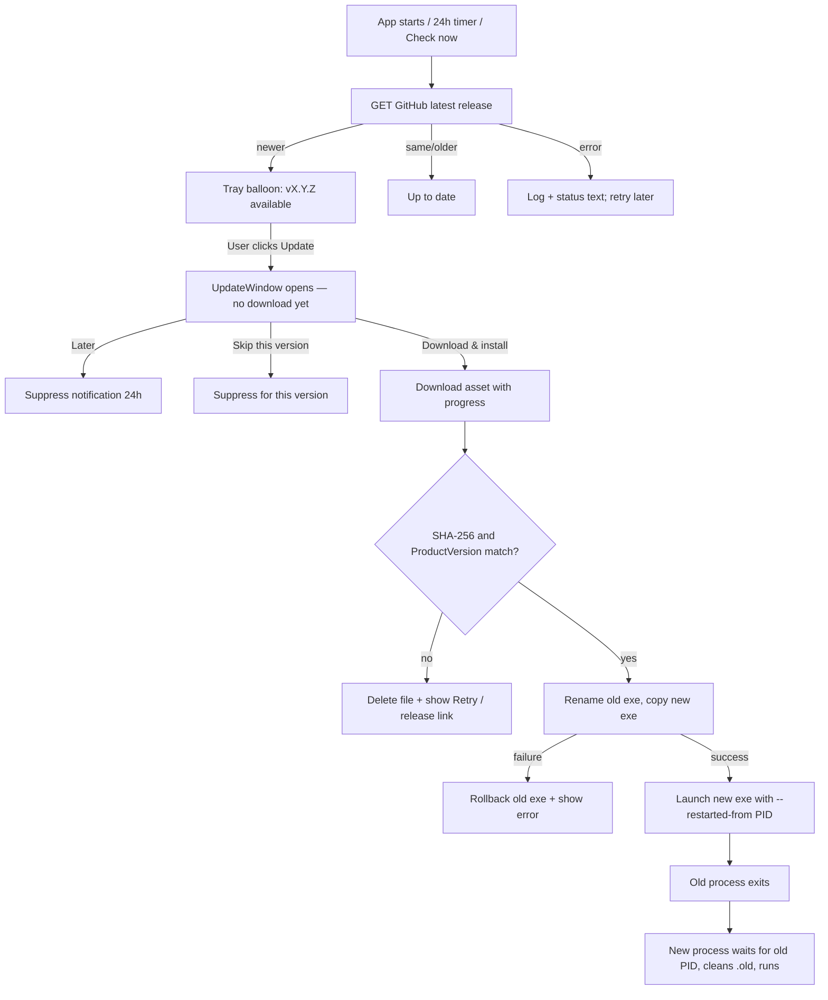

# Check for updates, propose, download on approval, replace and restart — plan

**Date:** 2026-11-19
**Status:** Implemented 2026-11-19 — commits `ad29e59`, `88b33b2`, `441d2ad`, `e3fd7b7`,
`94342c7`, `c4cafde`, `c88bacf`, `98a0617`, `949802e`, `b718e66`, `c00adc6`.
Manual end-to-end verification and the v2.1.0 release are not done.
**Feature request:** detect a newer release, notify the user, download **only after approval**,
verify it, replace the running `AiMeter.exe`, and restart the app.

## Implementation status (2026-11-19)

- **Delivered:** `AppVersion`/`AppInfo` (SemVer + informational-version parsing) and the 2.1.0
  version bump; `ReleaseInfo`/`ReleaseAsset`; `GithubReleaseFeed` with a host allow-list,
  pinned API version, digest-or-`.sha256` resolution and fail-closed validation;
  `FileUpdateStateStore`; `UpdateDownloader` (streaming, 200 MiB cap, per-hop redirect
  validation, SHA-256 plus embedded `ProductVersion` identity check, PID/guid-suffixed staging,
  7-day cleanup); `UpdateInstaller` (rename `.old`, copy, rollback, relaunch with
  `--restarted-from`) and the new-instance wait/cleanup; `UpdateManager` (15 s first check,
  30 min tick, 24 h gate, 10 s manual debounce, 1 h retry, Later/Skip semantics, consent gate);
  `IUiDispatcher`, `UpdateViewModel`, `UpdateWindow`, tray balloon and menu items, Settings →
  General → Updates card; `docs/releasing.md`, privacy/design updates, README **Updates**
  section, CHANGELOG Unreleased entry.
- **Verified:** `dotnet build AiMeter.slnx -c Release` succeeded (0 errors; 3 pre-existing
  nullable warnings in another session's test files); `dotnet test tests/AiMeter.Tests
  -c Release` passed (249 tests, 0 failed). Two review rounds; round 1 fixed version/checksum
  gating, download-timeout vs cancel, duplicate window buttons and the tray separator
  (`b718e66`); round 2 fixed skip-hides-install and the no-op Retry (`c00adc6`).
- **Not done:** manual E2E (§9) — needs two published builds and a local test feed; the
  v2.1.0 release itself (publish, tag, digest, README download link/hash, installer rebuild);
  code signing; automatic post-launch rollback/health check.

## Overview

AiMeter currently ships as a single framework-dependent `AiMeter.exe` (portable, 31 MB) and as a
per-user Inno Setup installer that installs to `%LocalAppData%\Programs\AiMeter`
(`installer/aimeter.iss:24-27`, `PrivilegesRequired=lowest`). Both locations are user-writable, so
in-place self-update is possible without elevation.

The update flow will be:

1. **Check** GitHub Releases for `LanternOfDarkness/AiMeter` at startup (after a short delay) and
   once per day while running, plus a manual **Check now** action.
2. **Propose** the update with a tray notification and a visible tray-menu item. No update bytes
   are requested at this point.
3. The user opens the update dialog and explicitly presses **Download & install**. Only then does
   the asset download start.
4. **Verify** the download against a SHA-256 value published with the release and against the
   exe's embedded version, then **replace** the running exe (rename the old exe, copy the new one
   into place, roll back on failure) and **restart** the app.
5. The new instance waits for the old process to exit, then cleans up the `.old` backup.

Deliverables:

1. `UpdateManager` — daily/manual check lifecycle, consent gate, state machine.
2. `GithubReleaseFeed` — GitHub Releases API client and release-asset contract.
3. `UpdateDownloader` — streaming download, size cap, SHA-256 verification, partial-file cleanup.
4. `UpdateInstaller` — safe in-place replacement, backup, rollback, relaunch.
5. Update UI — tray balloon notification, tray menu entries, `UpdateWindow`, Settings → General
   "Updates" card.
6. Release-process change — every release includes `AiMeter.exe` and a checksum
   (`AiMeter.exe.sha256`, or the GitHub `digest` field).
7. Tests, docs, changelog, privacy note.

## Current state (verified in code)

- `AiMeter.csproj:16-18` hardcodes `Version` / `AssemblyVersion` / `FileVersion` at `2.0.2`; no
  update code or HTTP client exists.
- `App.xaml.cs:26-53` registers services, managers, providers, view models and views in a
  `Microsoft.Extensions.Hosting` container. `OnStartup` starts `IProviderManager`, initializes the
  widget host, then creates/displays the tray icon (`App.xaml.cs:58-99`). `OnExit` disposes the
  tray icon, widget host and WebView clients (`App.xaml.cs:101-114`).
- The tray menu is defined inline in `App.xaml:9-21` with `Show Widget`, `Settings`, `Exit`.
- Settings → General is a stack of `SectionCard`s; the `GENERAL` card starts at
  `SettingsWindow.xaml:194` and the tab order is GENERAL → COLORS → ALERTS → ACCOUNTS. The view
  model is a singleton (`SettingsViewModel`), so a new Updates card can bind to one long-lived
  view model.
- `TrayViewModel` already receives singleton views (`SettingsWindow`) and opens them via
  `ShowOrActivate()` (`TrayViewModel.cs:11-35`). It holds no `TaskbarIcon` reference; the icon
  lives in `App` (`App.xaml.cs:72-93`).
- `Environment.ProcessPath` is already used for the startup registry entry
  (`Services/StartupManager.cs:34`); it is the correct path to replace.
- `publish/win-x64/` contains a single `AiMeter.exe` (31,461,672 B); there are no side-by-side
  files to update, which is what makes the one-file contract valid.
- `AssemblyInformationalVersion` is `2.0.2+4ae9bbe` (version plus source revision); the log stamp
  in `Logging/FileLogger.cs:20-33` already shows that shape. Any parser must strip `+...`.
- No single-instance guard exists anywhere in `src/`; two instances of the app can run (and would
  share version-keyed staging paths).
- The live `v2.0.2` release currently exposes `digest: sha256:4c76…` and **no**
  `AiMeter.exe.sha256` asset; `html_url` is present. The GitHub API returns the digest under the
  pinned `X-GitHub-Api-Version: 2022-11-28` header (checked 2026-11-19).
- `docs/privacy.md:36-38` documents a Microsoft Store package-data layout, but the repo has no
  Store/MSIX project. WindowsApps is read-only, so a packaged build can never self-update.
- The exe is unsigned today; SmartScreen warnings are documented in the README (`README.md:39-41`).

## Decisions

| # | Decision |
|---|----------|
| D1 | **Consent before download.** Checking the API is automatic; fetching the exe asset requires an explicit **Download & install** click. No silent background download, no silent install. |
| D2 | Stable releases only: `GET /repos/LanternOfDarkness/AiMeter/releases/latest`. Drafts and prereleases are ignored. |
| D3 | Update source is fixed in code (repository slug + `AiMeter.exe` asset name). No user-editable feed URL in Release builds. |
| D4 | **Fail closed on integrity.** Install only after SHA-256 matches. The hash comes from the release asset `digest` field when present, otherwise from the `AiMeter.exe.sha256` asset. If neither exists, refuse automatic install and offer the release page. |
| D5 | Update the **running exe in place**: rename the old file, copy the verified new file to the original path, relaunch, then exit. Keep the old file as a backup until the new instance has started. A failed copy deletes the partial target before restoring the backup. |
| D6 | Auto-update is enabled only for a **single-file, unpackaged** host (`Assembly.Location` empty, no MSIX/Store package identity) and not under a debugger / `#if DEBUG`. Framework-dependent `bin` builds, Store/MSIX builds and dev runs show "Automatic update unavailable" and link to the release page (Store builds say "Updates are handled by the Store"). |
| D7 | If the app directory is not writable, do not download the asset; open the GitHub release page instead. (Portable and the per-user installer are writable; this is a safety net for unusual placements.) |
| D8 | "Later" suppresses the notification for that version for 24 h, measured from when the notification was last shown or from the **Later** click if the user interacted with it. "Skip this version" suppresses it until a newer version appears **and clears the advertised update** (`HasAvailableUpdate` false, so the tray item and Settings card stop offering it); the release stays available for an explicit **Download & install**, and a manual check re-surfaces it as "skipped". The tray menu keeps the manual entry available. |
| D9 | No delta patching, no resume, no background service. A 31 MB full-exe download after explicit approval is acceptable. |
| D10 | No third-party updater framework (Velopack/Squirrel). They impose a packaging layout change and add a dependency; the current single-exe + checksum contract is simpler and testable. |
| D11 | **Post-download identity check.** After the hash matches, read the staged exe's `FileVersionInfo.ProductVersion`, strip `+...` and parse it with `AppVersion`; it must be `>= release.Version`. A mismatch means the release was uploaded with the wrong binary; treat it as an integrity failure rather than installing a downgrade. |
| D12 | No single-instance guard exists, and adding one is out of scope. Staged downloads use a PID/guid-suffixed filename, and cleanup only removes files this process created or staged files older than 7 days, so two instances cannot delete each other's work. |

## User flow



## Work items

### 1. Version + app identity

**New:** `src/AiMeter/Services/Updates/AppVersion.cs`

Semantic version value type:

```csharp
public readonly record struct AppVersion(int Major, int Minor, int Patch,
    string? Prerelease = null) : IComparable<AppVersion>
{
    public static bool TryParse(string text, out AppVersion version);
    public int CompareTo(AppVersion other);
    public override string ToString(); // "2.1.0" / "2.1.0-beta.1"
}
```

- Accept an optional leading `v`/`V`, 3 numeric parts, optional `-prerelease`.
- Reject 4-part versions, empty tags, malformed input.
- Implement SemVer 2.0 precedence: numeric parts, prerelease lower than release, dot-separated
  prerelease identifiers compared numerically then lexically.
- Ignore `+build` metadata, and normalize an empty prerelease string to `null` so `Equals` agrees
  with `CompareTo(...) == 0` (a `record struct` otherwise treats `""` and `null` as different).
- Cover the shapes that actually occur: `v2.1.0`, `V2.1.0`, `2.1.0+4ae9bbe`, `2.1.0-beta.1`,
  `2.1`, `2.1.0.0`.

**New:** `src/AiMeter/Services/Updates/AppInfo.cs`

```csharp
public static class AppInfo
{
    public static AppVersion Current { get; } // AssemblyInformationalVersion, strip "+..."
    public static string CurrentDisplay => "v" + Current;
}
```

The runtime value is `2.1.0+4ae9bbe` (see `Logging/FileLogger.cs:20-33`), so `Current` must cut at
the first `+` before parsing. Used by the UI, User-Agent, and update decisions. No dependency on
WPF.

**Change:** `AiMeter.csproj` — bump to the feature release version (recommend `2.1.0`) in all three
fields. A release must bump these before publishing; the updater reads the informational version.

### 2. Release feed + asset contract

**New:** `src/AiMeter/Services/Updates/ReleaseInfo.cs`

```csharp
public sealed record ReleaseAsset(
    string Name,
    Uri DownloadUrl,
    long Size);

public sealed record ReleaseInfo(
    AppVersion Version,
    string TagName,
    string HtmlUrl,              // html_url: the human release page used by every fallback
    string Notes,
    ReleaseAsset Asset,          // the AiMeter.exe asset
    string? Sha256,              // normalized 64-char lowercase hex, from GitHub digest
    ReleaseAsset? ChecksumAsset); // AiMeter.exe.sha256 when no digest is available
```

**New:** `IReleaseFeed` / `GithubReleaseFeed`

```csharp
public interface IReleaseFeed
{
    Task<ReleaseInfo?> GetLatestAsync(CancellationToken ct);
}
```

Implementation:

- Request `https://api.github.com/repos/LanternOfDarkness/AiMeter/releases/latest`.
- Headers: `User-Agent: AiMeter/<current>`, `Accept: application/vnd.github+json`,
  `X-GitHub-Api-Version: 2022-11-28`. No token, no cookies.
- Timeout 15 s. The `HttpClient` is a singleton; implement `IDisposable` and let `_host.Dispose()`
  release it (the container disposes `IDisposable` singletons in `App.OnExit`).
- Parse with `System.Text.Json` only the fields used: `tag_name`, `html_url`, `body`, `draft`,
  `prerelease`, `assets[].name`, `assets[].browser_download_url`, `assets[].size`,
  `assets[].state`, `assets[].digest`. The live API returns `digest` (lowercase `sha256:<64 hex>`)
  and `html_url` under the pinned API version.
- Reject the response if `draft` or `prerelease` is true (the `/latest` endpoint should already
  exclude them, but keep the guard).
- Parse `tag_name` with `AppVersion.TryParse`; log the tag and return `null` if it cannot be
  parsed (do not surface a broken release as "up to date").
- Require `html_url` to be `https`, host `github.com`, and path
  `/LanternOfDarkness/AiMeter/releases/tag/<tag>`; it is the only link offered when install is
  unavailable.
- Select exactly one asset named `AiMeter.exe` (case-insensitive), `state == "uploaded"`,
  `size > 0` and `size <= 200 MiB`. Log a warning when more than one matches and pick none.
- Resolve the checksum:
  1. Asset `digest` of the form `sha256:<64 hex>` (GitHub release-asset digest), if non-null.
  2. Otherwise an uploaded asset named `AiMeter.exe.sha256`, fetched later by the downloader; the
     feed stores its URL/size but not its contents.
  3. Otherwise `Sha256 = null` — **install disabled**, show the release page.
- Validate every URL: scheme `https`, host in
  `github.com` / `objects.githubusercontent.com` / `release-assets.githubusercontent.com` /
  `github-releases.githubusercontent.com`. Compare `Uri.Host` only (ignore the query string and
  its signature). Reject userinfo and non-default ports.
- Truncate `body` to 8,000 chars for the UI.
- Return `null` for 404 (no releases) — not an error.
- Map 403/429 with `X-RateLimit-Remaining: 0` to a typed `ReleaseFeedRateLimitedException`.
  The manager logs it and retries later; no modal dialog.
- Log status code and release tag only; never log the whole response body.

**New:** `IUpdateStateStore` / `FileUpdateStateStore`

Path: `%AppData%\AiMeter\update-state.json`. Separate from `settings.json` so notification
timestamps and dedupe state do not make Settings `Save()` noisy.

```csharp
public sealed class UpdateState
{
    public string? SkippedVersion { get; set; }
    public string? LastNotifiedVersion { get; set; }
    public DateTimeOffset? LastNotifiedUtc { get; set; }
    public DateTimeOffset? LastCheckUtc { get; set; }
}
```

- Atomic write (`update-state.json.tmp` then `File.Move(..., overwrite: true)`).
- Any parse/IO error → log, use an empty state, continue.
- `LastNotifiedUtc` is stamped when a notification is raised and refreshed when the user clicks
  **Later**; the 24 h dedupe compares against that value, so the suppression window starts at the
  click (D8).
- `LastCheckUtc` is written only after a successful API response; failures keep the in-memory
  `NextAttemptUtc` so a restart may retry sooner. Both values feed the Settings "Last checked" line.
- Do not store any machine or user identifiers.

**Change:** `Models/AppConfig.cs` — add `[ObservableProperty] private bool _checkForUpdatesAutomatically = true;`
The `SettingsManager` reflection copy already handles new properties, so no load/save change is
needed.

- The manager reads `Config.CheckForUpdatesAutomatically` on every loop tick, so unchecking it
  stops the background check immediately without a save.
- Do **not** add an immediate-save hook. `LaunchOnStartup` is registry-backed (`SettingsViewModel.cs:60-73`)
  and is not part of `settings.json`; copying that pattern is wrong. `SettingsManager.Save()`
  serializes the whole config (`SettingsManager.cs:49-59`), so saving on toggle would also persist
  every other live-bound edit and defeat Save & Close. Persist the toggle with the normal **Save**
  button.

### 3. Download + verification

**New:** `Services/Updates/UpdateDownloader.cs`

```csharp
public sealed record DownloadProgress(long BytesReceived, long? TotalBytes, double? Fraction);

public interface IUpdateDownloader
{
    Task<string> DownloadAsync(ReleaseInfo release, string destinationDirectory,
        IProgress<DownloadProgress>? progress, CancellationToken ct);
}
```

Rules:

- Destination: `%LocalAppData%\AiMeter\updates\AiMeter-<version>-<pid>-<guid>.exe.part`, renamed to
  `.exe` after verification. The unique suffix keeps two instances from sharing a partial file.
  Delete this process's leftovers on failure, plus any staged file older than 7 days at startup;
  never delete a `.part` that another live process created today.
- Stream with `HttpCompletionOption.ResponseHeadersRead`; 81,920-byte buffer; report progress at
  most ~10 times/second.
- Redirects: GitHub answers `github.com/.../releases/download/...` with a 302 to
  `release-assets.githubusercontent.com/...?...sig=...&se=...`, and **that 302 carries
  `Content-Length: 0`**. Use `AllowAutoRedirect = false` and validate every hop's host, or check
  `response.RequestMessage.RequestUri` before reading the body. Never persist the resolved
  presigned URI: it expires in about an hour, so every attempt must re-request the
  `browser_download_url`.
- Progress total comes from the **final** response's `Content-Length`. If it is absent (chunked),
  report `TotalBytes = null` and rely on the 200 MiB hard cap plus `release.Asset.Size` as a
  sanity check; do not reject a valid chunked response for lacking the header.
- Abort when the received byte count exceeds the asset size or 200 MiB, or when the final
  `Content-Length` differs from `release.Asset.Size`.
- Compute SHA-256 while streaming with `IncrementalHash`; compare case-insensitively with the
  expected hash.
- Hash source: use `release.Sha256` when the feed resolved GitHub's asset `digest`; otherwise
  download `release.ChecksumAsset` first (1 KiB cap), trim BOM/CRLF, and parse either `<hex>` or
  `<hex>  AiMeter.exe` (two spaces), requiring exactly 64 hex characters. If neither is
  available, install is disabled before this point (the UI offers the release page instead).
- **Identity check (D11):** after the hash matches, open the staged file with
  `FileVersionInfo.GetVersionInfo(...).ProductVersion`, strip `+...`, parse with
  `AppVersion.TryParse` and require `>= release.Version`. A parse failure or lower version is an
  integrity failure.
- On mismatch (hash or version)/cancel/IO error: delete the `.part` file and throw a typed
  `UpdateIntegrityException` / `UpdateDownloadException`. The staged `.exe` must not exist unless
  both checks passed.
- Never execute or `Process.Start` the downloaded file before verification.
- On success, return the final staged `.exe` path.

### 4. Replace + restart

**New:** `Services/Updates/UpdateInstaller.cs`

```csharp
public sealed record InstallResult(bool RestartStarted, string? Error);

public sealed record UpdatePreflight(bool CanUpdateInPlace, string? Reason);

public interface IUpdateInstaller
{
    UpdatePreflight CheckCanUpdateInPlace(); // single-file, package identity, write probe
    Task<InstallResult> ApplyAndRestartAsync(string stagedExePath, CancellationToken ct);
}
```

`CheckCanUpdateInPlace()`:

- `#if DEBUG` / `Debugger.IsAttached` / `Assembly.Location` non-empty → `false` with a
  "development build" reason.
- **Package identity check:** call `GetCurrentPackageFullName`; expect
  `APPMODEL_ERROR_NO_PACKAGE` (15700). Any other result means an MSIX/Store package, where the
  install directory is read-only and the Store owns updates → `false` with "Updates are handled by
  the Store". (`docs/privacy.md:36-38` already describes a Store layout.)
- `Environment.ProcessPath` must be an existing file named `AiMeter.exe`.
- Probe the app directory by creating and deleting `.aimeter-write-test` with retries. If it
  fails, `false` (caller offers the release page).

The launcher is injectable for tests: `Func<ProcessStartInfo, Process>` (registered as
`IProcessLauncher`) so `UpdateInstallerTests` can assert "relaunched once" without starting a real
process.

`ApplyAndRestartAsync` (runs on the UI thread, after the user approved the download and the file
verified):

1. `target = Environment.ProcessPath`; `appDir = Path.GetDirectoryName(target)`.
2. Backup path: `target + ".old"`. If it exists, try to delete it; if locked, use
   `target + ".old-" + DateTime.UtcNow.ToString("yyyyMMddHHmmss")`.
3. `File.Move(target, backupPath)` — Windows permits renaming a running executable (the loader
   opened it with delete sharing; this is the same trick Squirrel/Chrome use).
4. Copy the staged exe to `target`:
   - If the staging directory is on the same volume, `File.Move`; otherwise `File.Copy` then
     delete the staged file.
   - On failure (AV lock, disk full, ACL): **delete the partial `target` first** (best-effort),
     then `File.Move(backupPath, target)`. `File.Move` refuses an existing destination, so the
     delete is mandatory; deleting the staged file is optional. If the restore itself fails, stop
     and return an error that includes the backup path.
5. `Process.Start` via the injected launcher:
   `new ProcessStartInfo(target) { UseShellExecute = false, WorkingDirectory = appDir,
   ArgumentList = { "--restarted-from", Environment.ProcessId.ToString() } }`.
   - If start throws: delete the new `target`, restore the backup (same delete-then-move rule),
     and return the error. The current process keeps running.
6. Return success; the caller calls `Application.Current.Shutdown()` after a short dispatcher
   yield, allowing `OnExit` to dispose the tray icon, widget host and WebView clients.

**New-instance startup handling** — `App.OnStartup`:

- Parse `--restarted-from <pid>`. If present, wait for that PID to exit (poll every 250 ms, up to
  30 s) **before** `_host.StartAsync()` / provider startup. This avoids racing the shared WebView2
  profile (`%LocalAppData%\AiMeter\WebView2`, `ClaudeApiClient.cs:126`) and the deskband host's
  Explorer registration. Log a warning if the timeout expires and continue; the WebView2 layer may
  need its existing retry-on-lock behavior in that case.
- After `base.OnStartup(e)`, schedule a one-shot cleanup (30 s delay, up to 10 retries, 2 s apart)
  for `<target>.old` and `<target>.old-*` in the app directory; log failures but never fail
  startup. Only touch names derived from this exe, not every `*.old` in the directory.
- Ignore malformed/missing PID arguments; never throw from startup because of them.

**Backup/rollback limits (documented):** the old exe is kept as `.old` until the new instance is
running. If the new build crashes after launch, there is no automatic downgrade in this version;
the file is recoverable manually. Add one line to the README's Updates section: if the new build
does not start, rename `AiMeter.exe.old` back to `AiMeter.exe` (delete the failed `AiMeter.exe`
first). Automatic rollback/health-check is a follow-up, not part of this feature.

### 5. Orchestration

**New:** `Managers/IUpdateManager.cs` / `UpdateManager.cs`

State machine:

```
Idle → Checking → UpToDate | UpdateAvailable | CheckFailed
UpdateAvailable → Downloading → Verifying → Installing → Restarting
Downloading/Verifying → Failed (Retry)
UpdateAvailable → Deferred (Later) | Skipped (this version)
```

Public surface used by the UI:

```csharp
public enum UpdateCheckStatus { UpToDate, UpdateAvailable, Skipped, RateLimited, Failed }

public sealed record UpdateCheckResult(
    UpdateCheckStatus Status,
    ReleaseInfo? Release,
    string? Error);

public interface IUpdateManager
{
    AppVersion CurrentVersion { get; }
    ReleaseInfo? AvailableRelease { get; }   // newest release from the last check, even if skipped
    bool HasAvailableUpdate { get; }         // AvailableRelease != null && !IsSkipped
    bool IsSkipped { get; }                  // AvailableRelease matches SkippedVersion
    bool IsInstallable { get; }              // CheckCanUpdateInPlace() == true
    string? InstallUnavailableReason { get; }
    bool IsChecking { get; }
    bool IsDownloading { get; }
    double? DownloadFraction { get; }
    DateTimeOffset? LastCheckUtc { get; }
    string StatusText { get; }

    event EventHandler? StateChanged;
    event EventHandler<ReleaseInfo>? UpdateAvailable; // raised once per version per 24h

    Task StartAsync();
    Task StopAsync();
    Task<UpdateCheckResult> CheckAsync(bool manual, CancellationToken ct);
    Task DownloadAndApplyAsync(CancellationToken ct); // consent already given
    void DismissNotification();                       // Later; stamps LastNotifiedUtc = now
    void SkipAvailableVersion();                      // sets IsSkipped, persists SkippedVersion
}
```

Behavior:

- `StartAsync()` starts a background loop: wait 15 s (let the first usage poll and tray icon settle),
  then check if `LastCheckUtc` is older than 24 h; repeat every 30 min. A failed check retries after
  1 h (tracked in memory as `NextAttemptUtc`; a restart may retry sooner). Honor
  `Config.CheckForUpdatesAutomatically` on every tick; manual checks are always allowed.
- Manual checks are debounced: ignore a second `Check now` within 10 s (return the cached result)
  so the unauthenticated 60 req/h GitHub limit cannot be exhausted by clicking.
- All time decisions (24 h dedupe, 1 h retry, 10 s debounce) use the injected `TimeProvider`; tests
  advance a fake clock instead of sleeping.
- The loop skips a tick while `IsDownloading` is true; it never starts a second network operation
  during a download.
- Single-flight with a `SemaphoreSlim`; a manual click during an auto check joins/queues rather
  than starting two requests. `StartAsync` stores the loop task; `StopAsync` cancels the token,
  cancels any download, and awaits the loop so `OnExit` does not leave a background task touching a
  disposed `HttpClient`.
- `UpdateAvailable` is raised only when `release.Version > AppInfo.Current`, the version is not
  `SkippedVersion`, and the last notification for that version is older than 24 h (or a different
  version is now available). `AvailableRelease` is the single source of truth for the window;
  `HasAvailableUpdate` (used by the tray item and Settings card) is false while `IsSkipped`.
- `CheckAsync` always sets `AvailableRelease` to the newest release. On `Skipped` it leaves the
  release in place, sets `IsSkipped`, and suppresses `UpdateAvailable`; a manual check therefore
  re-surfaces the same release marked as skipped without notifying again. A newer version clears
  `IsSkipped` and notifies normally.
- `SkipAvailableVersion()` sets `IsSkipped`, persists `SkippedVersion`, and raises `StateChanged`;
  it never deletes `AvailableRelease` (an explicit **Download & install** still works).
- No download in `CheckAsync`. The asset is fetched only inside `DownloadAndApplyAsync`, called by
  the user's **Download & install** command.
- Preflight `CheckCanUpdateInPlace()` before offering the install button. If false:
  - still check and show release notes;
  - the primary button becomes **Open release page** (`Process.Start` with `UseShellExecute` on
    `release.HtmlUrl`);
  - surface `UpdatePreflight.Reason` (development build / Store / not writable);
  - do not download the asset into a dead end.
- Re-check the preflight immediately before starting the download; the directory can change
  between the check and the click.
- On success: update `LastCheckUtc`, persist state, clear any stale "available" notification.
- `StateChanged` is raised from the background loop; the manager never touches WPF objects.
  Consumers re-read all properties on the UI thread (see §6c).
- Exceptions are caught and logged with `ILogger<UpdateManager>`; user-facing messages are short
  and actionable.

**DI** — `App.xaml.cs`:

```csharp
services.AddSingleton<TimeProvider>(TimeProvider.System);
services.AddSingleton<IUiDispatcher, WpfUiDispatcher>();
services.AddSingleton<IReleaseFeed, GithubReleaseFeed>();
services.AddSingleton<IUpdateStateStore, FileUpdateStateStore>();
services.AddSingleton<IUpdateDownloader, UpdateDownloader>();
services.AddSingleton<IProcessLauncher, ProcessLauncher>();
services.AddSingleton<IUpdateInstaller, UpdateInstaller>();
services.AddSingleton<IUpdateManager, UpdateManager>();
services.AddSingleton<UpdateViewModel>();
services.AddTransient<UpdateBalloonViewModel>();
services.AddSingleton<Views.UpdateWindow>();
```

Startup order in `App.OnStartup`: subscribe to `IUpdateManager.UpdateAvailable`, finish creating
the tray icon (`ForceCreate()` at `App.xaml.cs:84-92`), then call `updateManager.StartAsync()` and
keep its task (the manager's `StopAsync` awaits the same loop). This guarantees the first
notification has a tray icon to attach to and a `CloseBalloon()` target.

### 6. UI

#### 6a. Tray notification — no download before approval

`App.OnStartup` subscribes to `IUpdateManager.UpdateAvailable` and marshals to the UI dispatcher
before creating the balloon (the manager may raise the event from its background loop). The
balloon must be a **fresh control per show**: H.NotifyIcon 2.4.1 throws when the control already
has a parent, and `CloseBalloon()` is the only way to dismiss it.

```csharp
var vm = _host.Services.GetRequiredService<UpdateBalloonViewModel>();
vm.Initialize(release, close: () => _notifyIcon?.CloseBalloon());
_notifyIcon.ShowCustomBalloon(
    new Views.UpdateBalloonView { DataContext = vm },
    PopupAnimation.Slide, 20000);
```

- **New:** `ViewModels/UpdateBalloonViewModel.cs` — `VersionText`, a short `NotesSummary`, and
  `UpdateCommand` / `LaterCommand`. It receives the release in `Initialize(...)` and a
  `close` callback from `App`; it does not reach into `App` or the tray icon itself.
- **New:** `Views/UpdateBalloonView.xaml` — small dark card: "AiMeter vX.Y.Z is available",
  notes summary, buttons **Update** and **Later**.
- **Update** → close the balloon, then `UpdateWindow.ShowOrActivate()`.
- **Later** → `IUpdateManager.DismissNotification()` (stamps the 24 h window) then close the
  balloon.
- The balloon is only a proposal. It contains no download logic and does not request the asset.
- If the custom balloon cannot be shown, the tray menu entry remains the fallback. No duplicate
  native toast is sent.

#### 6b. Tray menu

Change `App.xaml:9-21`:

- Add a conditional top item: `Update to vX.Y.Z…` bound to `ShowUpdateCommand`, visible only when
  `HasAvailableUpdate` (which is false after **Skip this version**).
- Add `Check for updates…` bound to `CheckForUpdatesCommand`: opens `UpdateWindow` and triggers a
  manual check if one has not completed yet (the manager debounces repeats).
- Keep `Show Widget`, `Settings`, `Exit` unchanged.

`TrayViewModel` gains `IUpdateManager` + `UpdateWindow`, exposes `HasAvailableUpdate`,
`AvailableUpdateText`, and implements `ShowUpdateCommand` / `CheckForUpdatesCommand`. It does not
close balloons (the balloon VM owns that) and does not implement a dismiss command. It subscribes
to `StateChanged`, marshals to the UI dispatcher and re-reads `AvailableRelease` / `IsSkipped` so
the menu item and text stay in sync after a background check or a skip.

#### 6c. Update window

**New:** `Views/UpdateWindow.xaml(.cs)` — singleton, dark themed like Settings, 480×440,
`ShowOrActivate()`, hide-on-close (same lifecycle as `SettingsWindow`).

**New:** `ViewModels/UpdateViewModel.cs` — all observable state and commands:

| Element | Behavior |
|---|---|
| Current / new version | `v2.0.2 → v2.1.0` |
| Release notes | Plain `TextBlock` in a max-height 160 `ScrollViewer`; no HTML/web rendering |
| Status | "Checking…", "You're up to date", "Update available", "Downloading 42%", "Verifying…", "Restarting…", error text |
| Primary button | **Download & install** (only when available and installable); **Open release page** when auto-install is unavailable; **Retry** after download failure; **Cancel** during download |
| Secondary | **Later**, **Skip this version**, **Release notes on GitHub** |
| Progress | Determinate when `Content-Length` is known, indeterminate while verifying |

Rules:

- Opening the window does not download anything. On first show, call
  `IUpdateManager.CheckAsync(manual: true)` only when `LastCheckUtc` is null (no check has run
  yet); otherwise render the current state. The first click of **Download & install** calls
  `IUpdateManager.DownloadAndApplyAsync`.
- Closing/hiding during download is blocked; the user must press **Cancel**, which cancels the
  token, deletes the `.part`, and stays on the available screen. Implement this in
  `UpdateWindow.OnClosing`, not in the view model.
- After a verified install, show "Restarting…". `UpdateViewModel.DownloadAndInstallCommand` calls
  `Application.Current.Shutdown()` only after `IUpdateManager.DownloadAndApplyAsync` returns
  success; the manager itself stays UI-agnostic.
- Threading: inject an `IUiDispatcher` (new `Services/Updates/IUiDispatcher.cs` /
  `WpfUiDispatcher.cs`, a tiny wrapper around `Application.Current.Dispatcher`, registered in
  `App`) or a `SynchronizationContext`; do **not** read `Application.Current.Dispatcher`
  inside the view model, so unit tests can run without WPF. On `StateChanged`, marshal once and
  then raise `OnPropertyChanged` for every mirrored property (`StatusText`, `DownloadFraction`,
  `IsChecking`, `IsDownloading`, `IsInstallable`, `IsSkipped`, `LastCheckUtc`,
  `AvailableRelease`). The manager does not implement `INotifyPropertyChanged`.
- The primary button follows `IsInstallable` / `AvailableRelease`: **Download & install** when
  installable, **Open release page** (`release.HtmlUrl`) when not, **Retry** after a failed
  download, **Cancel** while downloading. `InstallUnavailableReason` is shown as hint text.
- Progress is determinate only when the final response supplied `Content-Length`; otherwise show
  an indeterminate bar with the received MB count.
- **Skip this version** calls `SkipAvailableVersion()`; the window then shows "Skipped — you can
  still install it manually" with **Download & install** still available (an explicit click always
  overrides the skip) and the manager no longer raises notifications.
- `UpdateViewModel` is also exposed to Settings and TrayViewModel so state is consistent
  everywhere; do not duplicate polling or status text.

#### 6d. Settings → General → Updates card

Add to `SettingsWindow.xaml` in the General tab **after ALERTS and before ACCOUNTS** (the actual
order is GENERAL → COLORS → ALERTS → ACCOUNTS, `SettingsWindow.xaml:190-250`):

```
UPDATES
Current version: v2.0.2
[x] Check for updates automatically
Last checked: 2026-11-19 14:02 (or "Never")
Status: Update available — v2.1.0 / You're up to date / Updates are handled by the Store / …
[Check now]
```

- Bind to `UpdateViewModel` (`SettingsViewModel.Updates` property). `SettingsViewModel` gains an
  `UpdateViewModel` constructor parameter; update the two test helpers that construct it
  (`SettingsViewModelResyncTests.cs:31`, `SettingsViewModelCustomizationTests.cs:22-23`).
- `Check for updates automatically` binds **directly** to `Config.CheckForUpdatesAutomatically`.
  The manager reads the config live each tick, so unchecking stops the loop immediately; the value
  is persisted by the normal **Save** button. Do not add an immediate-save hook — see §2's note on
  `Save()` serializing the whole config.
- **Last checked** formats `UpdateViewModel.LastCheckUtc` in local time, or "Never".
- **Check now** is enabled when no check/download is in progress; it calls
  `CheckAsync(manual: true)` and updates the status line. The manager debounces repeats.
- When a newer version is found, show an **Open update** button (resolved on demand via the
  existing `IServiceProvider`, as `SettingsViewModel` already does) that calls
  `UpdateWindow.ShowOrActivate()`. The download still requires the explicit **Download & install**
  click in that window.
- When `IsInstallable` is false, the status line includes `InstallUnavailableReason` (development
  build / Store / directory not writable) so the user understands why the button is missing.
- No download is triggered from Settings without the same dialog/approval.

### 7. Release contract changes

Every release that should be updatable must publish:

| Asset | Required | Notes |
|---|---|---|
| `AiMeter.exe` | yes | The single-file publish output; exact name used by the updater. |
| `AiMeter.exe.sha256` | optional | One line: `<64 hex>  AiMeter.exe`. Defensive fallback used only when GitHub's asset `digest` is absent; the live `v2.0.2` release has a digest and no such asset. |
| `AiMeter-setup-x64.exe` | optional | Installer/fallback distribution; the updater does not use it. |

- Tag format: `vX.Y.Z` matching the csproj `Version`. `/releases/latest` excludes prereleases.
- First updater release (recommended `v2.1.0`) must be published with a digest (GitHub adds it
  automatically) and, optionally, the `.sha256` asset; older releases lack the updater and are not
  expected to be self-updatable.
- The identity check (D11) reads `ProductVersion` from the uploaded exe, so the tag, `Version`, and
  the binary actually uploaded must agree. If they don't, every client refuses the update.
- The updater only replaces `AiMeter.exe`; it cannot install side-by-side files. Today's publish
  output is one file (verified in `publish/win-x64/`). If a future release adds companion files,
  the asset contract and installer must be extended first.
- Add a short **Release checklist** in a new `docs/releasing.md` (does not exist yet) and link it
  from the README:
  1. bump `Version` / `AssemblyVersion` / `FileVersion`;
  2. `dotnet publish src/AiMeter/AiMeter.csproj -c Release -r win-x64 --self-contained false -p:PublishSingleFile=true -o publish/win-x64`;
  3. `Get-FileHash publish/win-x64/AiMeter.exe -Algorithm SHA256` → write `AiMeter.exe.sha256`;
  4. verify the exe is still a single file (no side-by-side files were added);
  5. upload `AiMeter.exe` (and the `.sha256`) to the `vX.Y.Z` release and confirm the release page
     shows the digest;
  6. update the versioned download link and hash in `README.md:25-36`, `CHANGELOG.md`, and the
     installer if it is rebuilt.
- No GitHub Actions workflow exists today; the checklist is manual. A future CI job can automate
  the hash asset.
- **Installer caveat:** after a self-update, Inno's Add/Remove Programs entry still shows the
  version from the last installer run. That is expected; document it next to the checklist rather
  than trying to rewrite uninstall metadata from the app.

### 8. Security notes

- Only `https://api.github.com/repos/LanternOfDarkness/AiMeter/releases/latest` and allow-listed
  GitHub download hosts are contacted.
- Download redirects carry a short-lived signed query (`sig`, `se`); treat the resolved URL as a
  secret-in-transit: never log it, never persist it, and re-request `browser_download_url` on every
  attempt. Log only the host.
- Hash verification prevents truncated/corrupted downloads, but the hash comes from the same
  release API. It does **not** protect against a compromised repository/release token. Code
  signing (Authenticode) remains the follow-up for provenance and SmartScreen trust; the updater
  must not be treated as a substitute.
- The identity check (D11) catches an operator error (wrong binary uploaded for a tag) that the
  hash cannot catch, because the hash is computed from whatever was uploaded.
- MSIX/Store packages never self-update (`CheckCanUpdateInPlace()` refuses); the Store owns that
  channel. This matters because `docs/privacy.md` already documents a Store data layout.
- Never run the staged exe directly. Only the in-place copy at the original `AiMeter.exe` path is
  started, and only after hash and version verification.
- No credentials, cookies, settings, or usage data are sent to GitHub. The update check does
  reveal the source IP and the `AiMeter/<version>` User-Agent to GitHub, like any HTTPS request.
- Debug-only test override: compile an optional feed-URL override under `#if DEBUG` (for a local
  HTTP test server); Release builds have no override knob. Never add a user-editable feed URL.

### 9. Testing

**Unit tests** (`tests/AiMeter.Tests`, xUnit + FluentAssertions, hand-written fakes — existing
style):

| Test file | Covers |
|---|---|
| `AppVersionTests.cs` | `v2.0.2`, `V2.1.0`, `2.1.0+4ae9bbe`, prerelease precedence, release > prerelease, build metadata ignored, `2.1` / `2.1.0.0` rejected, empty prerelease normalized, `Equals` matches `CompareTo == 0`. |
| `AppInfoTests.cs` | `Current` strips `+4ae9bbe`; a malformed informational version falls back to `Assembly.Version` (3-part). |
| `GithubReleaseFeedTests.cs` | JSON fixture: tag/asset selection, duplicate `AiMeter.exe` rejected, `draft`/`prerelease` rejection, missing/oversized asset, digest normalization, `digest: null` → `.sha256` fallback URL, `.sha256` absent → `Sha256 == null`, unparseable tag, `html_url` validation, query string ignored in host checks, disallowed host, 404 → null, 403 rate limit → typed exception. |
| `UpdateDownloaderTests.cs` | Fake `HttpMessageHandler`: streaming to a temp file, progress reporting (with and without `Content-Length`), 302 hop with `Content-Length: 0` followed by the real length, redirect to a disallowed host, size mismatch, hash mismatch deletes `.part`, ProductVersion lower than the tag deletes `.part`, cancellation cleanup, unique staging filename, two sequential attempts re-request the original URL, `.sha256` file parsing (BOM/CRLF/one or two spaces). |
| `UpdateInstallerTests.cs` | Temp-directory replacement with dummy files; backup created; copy failure deletes the partial target and restores the backup; start failure restores the backup; injected launcher invoked once; write-probe failure returns `CheckCanUpdateInPlace().CanUpdateInPlace == false`; package-identity probe returning packaged yields a "Store" reason. The running-exe rename itself is exercised manually. |
| `UpdateStateStoreTests.cs` | Atomic save/load, corrupt JSON fallback, `SkippedVersion` round-trip, notification dedupe timestamps (raise vs Later click), `LastCheckUtc` only on success. |
| `UpdateManagerTests.cs` | Fake feed/downloader/installer/clock: no download during `CheckAsync`; newer version raises `UpdateAvailable`; skipped version suppressed (`HasAvailableUpdate` false, `IsSkipped` true, `AvailableRelease` retained); manual check re-surfaces it as skipped; 24 h dedupe; manual debounce; no checks while downloading; `LastCheckUtc` after success; preflight false never downloads; consent gate (installer not called until `DownloadAndApplyAsync`); failures do not crash. |
| Existing settings tests | `SettingsViewModel` gains `UpdateViewModel`; update `SettingsViewModelResyncTests` / `SettingsViewModelCustomizationTests` helpers and `FakeServiceProvider` with a fake update manager. |

Do not add tests for XAML wiring or notification rendering; verify those manually.

**Manual end-to-end** (required before release):

1. Create two local builds with different `Version` values (e.g. 2.1.0 and 2.1.1) from the same
   publish command; serve the newer `AiMeter.exe` with a digest-only response and with a
   `.sha256` asset from a local HTTPS test feed using the Debug-only override.
2. Run 2.1.0 from a writable folder.
3. Confirm the balloon appears, and **no asset request** is issued until **Download & install** is
   clicked (watch the test server log). Dismiss with **Later** and confirm the balloon closes and
   no second notification appears within 24 h.
4. Approve, observe progress, verify the exe is replaced, the new process starts, the tray/widget
   return, and `AiMeter.exe.old` is removed after startup.
5. Repeat with a deliberately wrong hash → download fails, old exe remains, app keeps running.
6. Repeat with a correctly hashed **wrong-version** binary under a newer tag → the identity check
   rejects it and the old exe remains.
7. Repeat with a read-only app directory → **Open release page** is offered instead of download.
8. Verify **Skip this version** clears the tray item and the Settings "Update available" state, a
   manual **Check now** re-surfaces it as skipped, and the manual check is debounced.
9. Verify offline check, GitHub 404/no releases, and a 403 rate-limit response.
10. Start two instances from the same folder; confirm they use distinct `.part` files and only one
    installs.
11. Repeat the successful update in **Deskband mode**; confirm Explorer re-hosts the widget after
    the restart and the old process's deskband host is gone.
12. Verify a Debug build (and a `bin` framework-dependent build) does not attempt to self-update.
13. If a packaged/Store build exists, verify it reports "Updates are handled by the Store".
14. Simulate a broken new build: kill it before it cleans up, then rename `AiMeter.exe.old` back
    and confirm the README recovery steps work.

**Narrow verification during implementation:** `dotnet test` for the new unit tests, then
`dotnet build -c Release`, then the manual staged-update run above. Do not rely on the unit tests
for the running-exe replacement.

### 10. Docs / privacy / changelog

- `README.md`: add an **Updates** subsection — daily check, consent before download, manual check
  from tray/Settings, portable + per-user installer support, fallback to the release page when the
  install directory is not writable, Store builds update via the Store, and the manual recovery
  step (rename `AiMeter.exe.old` back if a new build won't start). Link `docs/releasing.md`.
- `docs/privacy.md`: add "Update check: a request to the GitHub Releases API containing the app
  version; no identifiers, cookies, or usage data. GitHub sees the request's source IP, like any
  HTTPS request. Release downloads come from GitHub."
- `docs/releasing.md` (new): the checklist from §7, including the identity check and the
  Add/Remove Programs version caveat.
- `docs/design.md`: change the goal line "Automatic updates without user interaction" (`:30`) to
  "Consent-based update checks and in-place updates" (superseded by the explicit approval
  requirement).
- `CHANGELOG.md`: entry under Unreleased.
- Delete/avoid temporary test scripts after the manual E2E.

## Sequencing

| # | Work item | Depends on | Risk |
|---|-----------|-----------|------|
| 1 | `AppVersion`, `AppInfo`, csproj version bump, state store | — | low |
| 2 | `ReleaseInfo` (incl. `HtmlUrl`), `GithubReleaseFeed`, JSON fixtures and tests | 1 | low/medium — strict URL/digest validation |
| 3 | `UpdateDownloader` + hash/identity tests | 1, 2 | medium — streaming/redirect/hash/version/cancel cleanup |
| 4 | `UpdateInstaller` + restart arg handling + backup cleanup | 1 | **high** — replacing the running exe; implement the partial-target delete and injected launcher before writing the happy path |
| 5 | `UpdateManager` orchestration, DI, background loop | 2, 3, 4 | medium — consent gate, throttling, single-flight, skip state |
| 6 | `UpdateViewModel`, `UpdateWindow`, tray balloon/menu, Settings card | 5 | medium — UI threading (IUiDispatcher), balloon close callback, state consistency |
| 7 | Release checklist (`docs/releasing.md`), docs, privacy, changelog | 6 | low |
| 8 | Manual E2E (two versions, wrong hash/version, read-only, two instances, Deskband) | 4–6 | required gate |

Suggested implementation order: 1 → 2 → 3 → 4 → 5 → 6 → 7 → 8. Work items 2 and 3 can be done in
parallel once 1 lands. Finish the item-5 contract (`LastCheckUtc`, `UpdateCheckResult`, skip state)
before item 6; do not start the UI before the manager's consent gate is fixed and tested. Item 4
must land with its temp-directory tests before any manual restart attempt.

## Acceptance criteria

- Starting an older build with a newer stable release available shows a tray notification within
  the configured delay; **zero asset bytes** are downloaded before the user approves.
- `Download & install` downloads the exact `AiMeter.exe` asset, verifies SHA-256 **and** the
  embedded `ProductVersion`, replaces the running exe, relaunches it, and the old process exits;
  the new instance reports the new version.
- A wrong/missing hash, a wrong-version binary, network failure, disk error, or unwritable app
  directory leaves the old working exe in place and shows an actionable message/link. A failed
  restore still reports the `.old` path.
- Digest-only releases work (today's `v2.0.2` shape); the `.sha256` fallback also works; a release
  with neither is never auto-installed.
- `Later` closes the balloon and suppresses it for 24 h from the click. `Skip this version` clears
  the tray item and Settings state and is re-surfaced (marked skipped) only by a manual check.
- Manual check, auto-check toggle (live, persisted on Save), offline/404/403 behavior, and the
  10 s manual debounce work as specified.
- Portable and Inno per-user installs both update; Store/MSIX packages, Debug runs and
  framework-dependent `bin` builds never self-update.
- Two concurrent instances do not share or delete each other's staged files.
- `dotnet test` passes, Release build succeeds, and the manual E2E (including Deskband restart and
  the wrong-version case) passes.

## Open inputs

- Confirm the feature release number (recommend `2.1.0`).
- Confirm the checksum asset policy: GitHub's `digest` is present on `v2.0.2` and is the primary
  source; `AiMeter.exe.sha256` is optional and only needed if a release lacks a digest.
- Confirm whether a Microsoft Store/MSIX package is still planned. If so, it must ship with
  self-update disabled (`CheckCanUpdateInPlace()` returns "Store") and the README/privacy text must
  say the Store owns updates.
- Code signing is **not** in scope; keep the README SmartScreen note and treat Authenticode as a
  follow-up. Automatic post-launch rollback/health-check is also a follow-up; this version
  documents the manual `.old` recovery.
